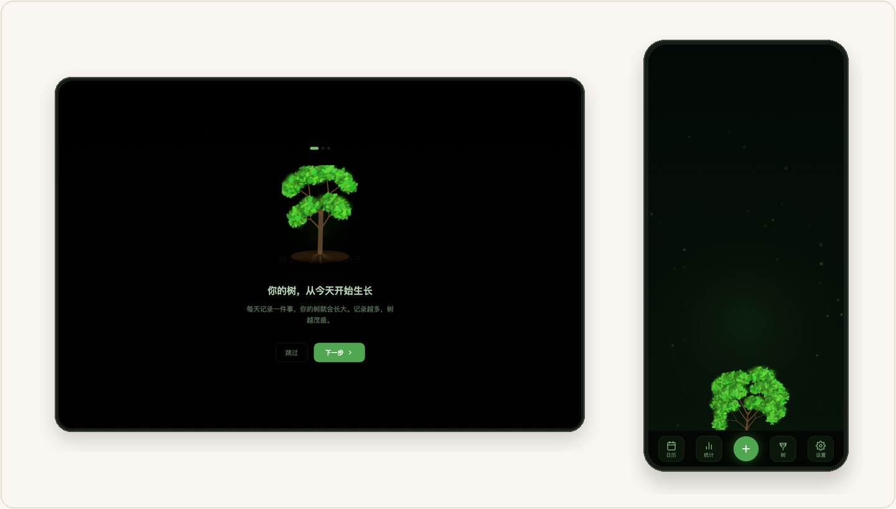

<div align="center">

# Daily Tree · 记忆森林

**每天留下一件值得记住的事，让屏幕里的小树跟着你的日常慢慢抽枝长叶。**

<p>
  <a href="https://nuts-and-bytes.github.io/daily-tree/app/"><strong>种一棵树 ↗</strong></a> ·
  <a href="https://nuts-and-bytes.github.io/daily-tree/">项目介绍页</a> ·
  <a href="#快速开始">本地运行</a> ·
  <a href="#english">English</a>
</p>

<br />



</div>

## 为什么做它

日记本很容易写两天就落灰，因为每天记下的细碎情绪看不到积累的形状。

**Daily Tree** 想给日常一点看得见的生命力：每天只需写下一句话、贴一张图，屏幕中央的小树就会从一粒种子、嫩芽、幼苗一路长成青树与古树；打开日历与天气，翻回过去的某一天，每一片叶子背后都藏着你认真活过的日子。

## 核心体验

- **随记录生长的树**：Canvas 程序化有机枝干，依据累计天数解锁 6 个生长阶段（种子 → 嫩芽 → 幼苗 → 青树 → 壮年树 → 古树）。
- **轻量图文手记**：专注当下的一句话与图片记录，打开即写，没有社交压力与复杂标签。
- **日历与时间轴回看**：按日历或底部日期滑轨快速穿梭过去，重温当天的文字与照片。
- **实景天气氛围**：可选授权定位，根据实时天气为夜空叠加微雨、微风等氛围效果。
- **本地存储与导出**：免注册即用，支持随时导出与恢复本地记录。

## 快速开始

纯静态应用，无需安装后端依赖，使用 Python 3 即可本地预览：

```bash
git clone https://github.com/nuts-and-bytes/daily-tree.git
cd daily-tree
python3 -m http.server 8000
```

浏览器访问 <http://localhost:8000/app/>（介绍页位于 <http://localhost:8000/>）。

<details>
<summary><strong>目录结构、数据与使用边界</strong></summary>

<br />

- **核心文件**：`app/` 为当前主应用（`tree.js` 负责 Canvas 树木绘制，`db.js` 与 `image-compressor.js` 处理图片存储，`weather.js` 接入天气）；`app/webgl/` 为早期 WebGL 实验代码；部署说明见 [DEPLOYMENT.md](DEPLOYMENT.md)。
- **数据与备份**：文字保存在浏览器 `LocalStorage`，图片保存在 `IndexedDB`，不自动跨设备同步。当前的 JSON 备份仅包含文字记录，不含 `IndexedDB` 中的图片，换设备或清理浏览器缓存前请另外保存原图。
- **联网说明**：仅在授权天气功能时向 Open-Meteo 发送定位坐标获取天气。
- **许可**：采用 [MIT License](LICENSE)。

</details>

## English

**Daily Tree (记忆森林)** is a minimalist, browser-based daily journal that turns your accumulated memories into a growing Canvas tree—evolving from a seed to an ancient canopy as you write and save photos day by day.

- [Open app ↗](https://nuts-and-bytes.github.io/daily-tree/app/) · [Landing page ↗](https://nuts-and-bytes.github.io/daily-tree/)
- Run locally: `python3 -m http.server 8000` and open `/app/`. Entries live locally in your browser (LocalStorage for text, IndexedDB for images), with optional weather atmosphere powered by Open-Meteo.

---

<p align="center">made by <a href="https://heystone.site/">stone</a> · 为 AI 世界留一点人味</p>
